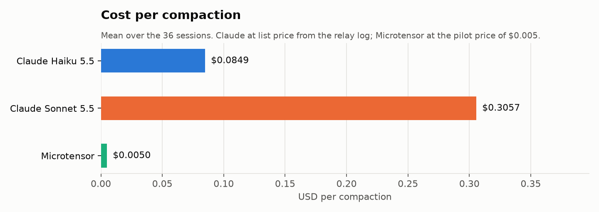
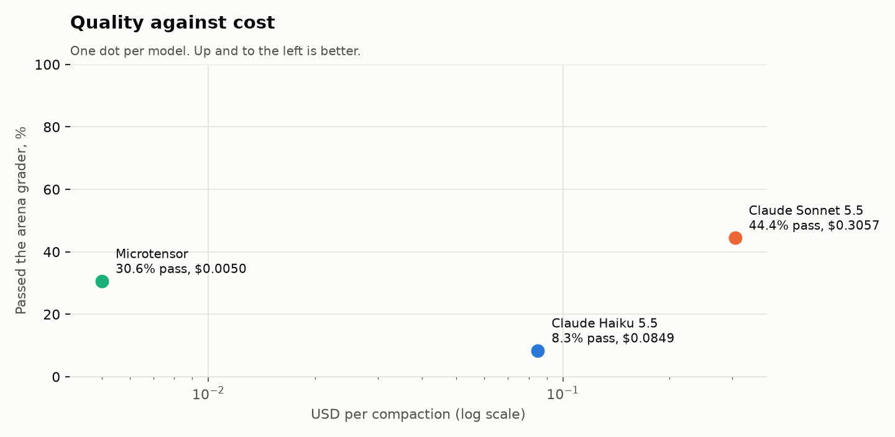
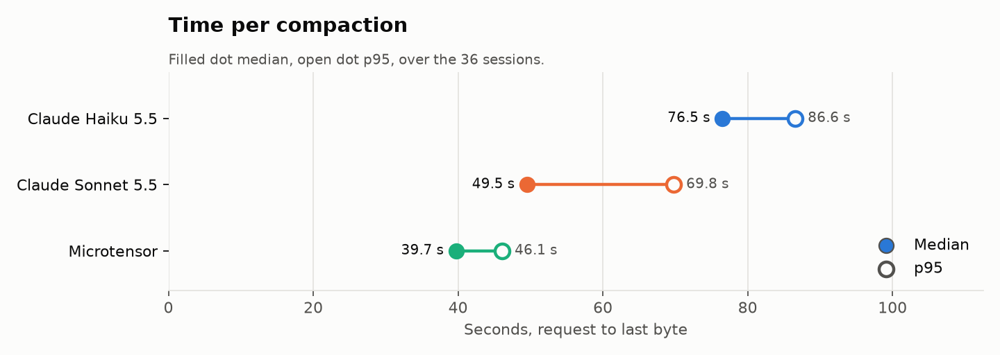
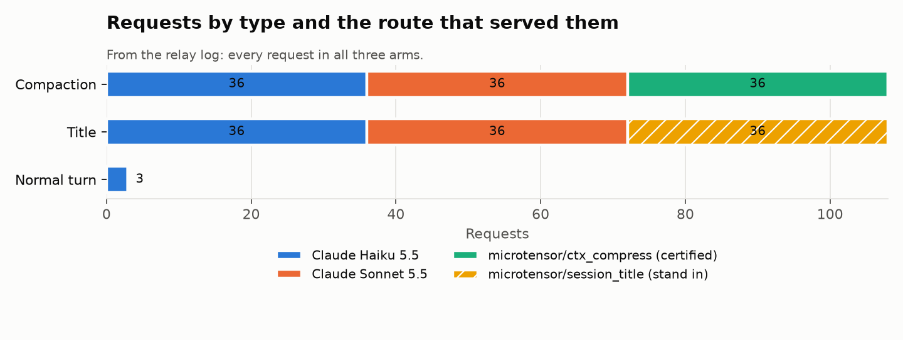
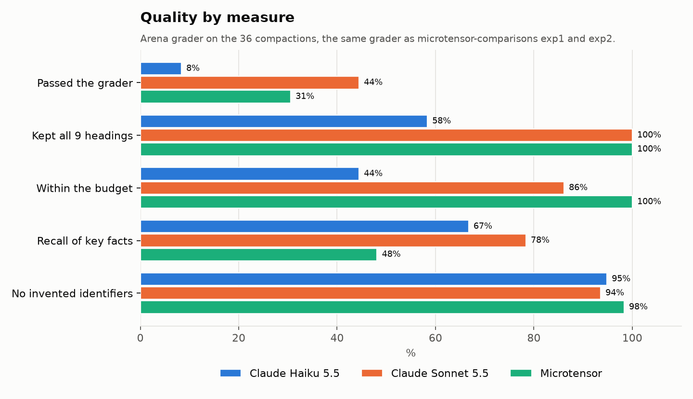
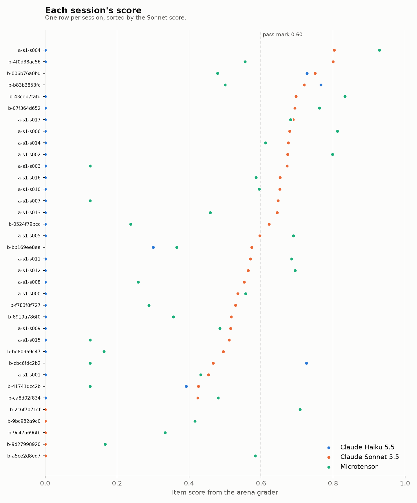

# Ditto pilot: Microtensor routes behind the Ditto Router

Ditto's router sorts every request a coding harness sends (Claude Code, Codex) by its shape and sends each kind to the cheapest route that still works. This pilot shows that the router can send any kind of request to Microtensor, one certified model per kind, with compaction as the first one.

Nothing here needs Ditto's private backend. It builds against Ditto's public router contract (`ditto-subnet/docs/router-compression-competition-v1.md`), so the same lever can later run inside their gateway in shadow mode.

## Replay bench results

Router fork: [microtensor-io/ditto-subnet, branch `microtensor-route-table`](https://github.com/microtensor-io/ditto-subnet/tree/microtensor-route-table/miners/dittobench-router-starter-kit). Every item side by side: the private Hugging Face dataset `microtensor-io/ditto-pilot-results`.

Each of the 36 sessions from Woolford's compaction study replication package (MIT) becomes the compaction request Claude Code sends: the conversation as user, assistant, tool use and tool result turns, then Claude Code's own compaction instruction (`replay/claude_code_compact_instruction.txt`) with `max_tokens` 20000. Each request goes through the router fork three ways: lever off to Claude Haiku 5.5, lever off to Claude Sonnet 5.5, and lever on, which sends compaction to `mt/ctx_compress`. Title requests (Claude Code's title shape, our wording) and three normal turns go through the same way. Summaries are graded with the arena grader used in microtensor-comparisons exp1 and exp2, after Claude Code's numbered summary is mapped back to the nine headings. Cost comes from the relay log at the prices in `catalog.json`; time is measured at the client, request to last byte.

<!-- results:start -->
| | Claude Haiku 5.5 (default) | Claude Sonnet 5.5 (default) | Microtensor route table |
|---|---|---|---|
| Compactions answered | 36 | 36 | 36 |
| Passed the arena grader | 3 | 16 | 11 |
| Pass rate | 8.3% | 44.4% | 30.6% |
| Kept all 9 headings | 21 | 36 | 36 |
| Within the arena budget | 16 | 31 | 36 |
| Recall of key facts | 66.7% | 78.4% | 48.1% |
| Hallucination | 5.2% | 6.5% | 1.7% |
| Continuation | 0.46 | 0.52 | 0.49 |
| Score without the budget rule | 0.35 | 0.61 | 0.48 |
| Cost per compaction | $0.0849 | $0.3057 | $0.0050 |
| Median time | 76.5 s | 49.5 s | 39.7 s |
| p95 time | 86.6 s | 69.8 s | 46.1 s |
| Errors | 0 | 0 | 0 |

| Titles | Claude Haiku 5.5 (default) | Claude Sonnet 5.5 (default) | Microtensor route table |
|---|---|---|---|
| Answered | 36 | 36 | 36 |
| Valid JSON title | 36 | 36 | 36 |
| 3 to 7 words | 35 | 36 | 29 |
| Median time | 0.6 s | 1.1 s | 44.3 s |
| Cost per title | $0.0000 | $0.0006 | $0.0000 |

Normal turns through the route table: 3 of 3 answered, 3 served by the model they asked for, so the table left them alone.

### Charts



Numbers: [cost_per_compaction.csv](results/charts/cost_per_compaction.csv)



Numbers: [quality_vs_cost.csv](results/charts/quality_vs_cost.csv)



Numbers: [time_per_compaction.csv](results/charts/time_per_compaction.csv)



Numbers: [requests_by_type_and_route.csv](results/charts/requests_by_type_and_route.csv)



Numbers: [quality_by_measure.csv](results/charts/quality_by_measure.csv)



Numbers: [session_scores.csv](results/charts/session_scores.csv)
<!-- results:end -->

### Run notes, 2026-11-09

- Microtensor served from one RTX 3090 (24 GB) on a RunPod community host, the only CUDA 13 card free that morning. Its times are 3090 times.
- The card failed one of three admission probes on the nine headings and was admitted by hand on the operator's word so the run could start.
- The certified model reached its 3,072 token output limit on 28 of 36 compactions. The gateway's repair step trimmed the repeated text and kept all nine headings, so every Microtensor summary has them, and its recall is lower.
- Claude Haiku 5.5 used its 20,000 token limit on 17 of 36 compactions, mostly on thinking, and those summaries stop before the end. That is the request Claude Code sends; nothing was changed for Haiku.
- The arena grader caps a summary at 3,072 tokens. Most complete Haiku and Sonnet summaries are longer and fail on that rule alone. The row "Score without the budget rule" compares the content on equal terms.
- One session, `exp1-b-07f364d652`, has tool results that arrive a turn late, and Anthropic refused it as first built. The builder now moves each late call next to its result and closes a call left open with Claude Code's interrupted result. All three arms reran that session, and the outputs and relay log hold the rerun.
- The title route is a stand in: Qwen2.5 1.5B on the pod's CPU, not a certified Microtensor model. Its 44 s is the CPU.
- Anthropic cost of the run at list price, from the relay log: $14.38.
- Raw data: `results/outputs/` (every reply), `results/relay.jsonl` (one line per request), `results/graded/` (every grade), `results/run/` (pod and rerun logs).

## Request types and the Microtensor arena that serves each

| Ditto request type | What Ditto measured | Microtensor route | Serves it now | Next |
|---|---|---|---|---|
| Compaction, and proactive compaction snapshots | Served in seconds, but cheap models lose detail | `microtensor/ctx_compress` | `mt/ctx_compress`, certified, live on testnet | Next epochs of the same arena |
| Titles and asides | Title prompt about 10 times cheaper on a flash model | `microtensor/session_title` | Stand in only: Qwen2.5 1.5B Instruct, clearly labelled, not a certified Microtensor model | A titles and asides arena |
| Tool descriptions | Prefix 16% smaller, 8 of 8 tasks still pass | not routed yet | none | A tool digest arena |
| Tool results | 97% removed on a 110 KB log, 22% on Bash output | not routed yet | none | A result compression arena |
| Memory | Five task suite cost fell from $4.31 to $0.71 | not routed yet | none | Memory extraction and rerank arenas |

Adding a type means adding one detector to the router's lever table, one line in the router config and one entry in `catalog.json`. Nothing else changes.

## How the pieces fit

```
Claude Code ──► Ditto router fork (lever table) ──► this relay ──► Anthropic (main turns)
                                                        ├──► api.microtensor.cloud /v1/messages (mt/<arena>)
                                                        └──► stand in model (labelled, demo only)
```

1. **Router fork, lever table.** A fork of `ditto-assistant/ditto-subnet`, folder `miners/dittobench-router-starter-kit`. Each detector looks at the request shape only and maps to a Microtensor route id from config, for example `compaction → microtensor/ctx_compress` and `aside → microtensor/session_title`. A match rewrites only the `model` value with the kit's own `splice_model`; every other byte is unchanged. Off by default: with no table configured the router is a byte for byte pass through.
2. **This relay.** Plays the part of Ditto's validator relay. It checks the ticket, reads the route id from the request's `model`, looks it up in `catalog.json`, refuses anything not in the catalog with `route_not_in_catalog`, never retries and never falls back, streams the reply back unchanged and logs one line per call.
3. **Microtensor gateway adapter.** `api.microtensor.cloud` serves `/v1/messages` and `/v1/chat/completions` for any certified model by name (`mt/<arena>`), each with its own input limit and output format. Inputs over a model's limit get an HTTP 413 so the router can fall back.
4. **Bench.** Arm A runs Claude Code through the router with the lever table off, arm B with it on. Same Claude Code version, model, tasks and order, in the same hour, two runs each. Ditto's gate comes first: arm B must pass within 5 points of arm A, and only then do cost and time count.

## The relay

```bash
pip install -r requirements.txt
export DITTOBENCH_RELAY_TICKET=...        # the router sends this as its bearer
export MICROTENSOR_API_KEY=...            # a Microtensor API key
export ANTHROPIC_API_KEY=...              # for the main turns
python -m relay --catalog catalog.json --log logs/relay.jsonl --port 8090
```

Then point the router fork at it with `DITTOBENCH_RELAY_BASE_URL=http://127.0.0.1:8090` and `DITTOBENCH_RELAY_TICKET`.

| Route | Upstream |
|---|---|
| `provider_api: anthropic` | the catalog's `base_url` with the key from the named env var; the body is forwarded unchanged |
| `provider_api: microtensor` | `https://api.microtensor.cloud`, with the route id rewritten to the catalog's model (`microtensor/ctx_compress` becomes `mt/ctx_compress`) |
| `provider_api: openai_compat` | stand ins only: a text only Anthropic Messages request becomes a Chat Completions call and the reply becomes Anthropic Messages again, streaming included. The catalog refuses an `openai_compat` route that does not say `stand_in: true` |

Every call logs: run id, arm, step (`x-dittobench-step`), route id, upstream model, input, cached and output tokens, cost in USD micros from the catalog prices, time to first byte, time to first token, total time, HTTP status, whether the route is a stand in, and the request shape (tools, tool choice, max tokens, number of messages, size of the last user message and of the system prompt). `POST /relay/label` with the ticket sets the run id and arm for the calls that follow. `GET /relay/health` lists the routes.

Capture mode for step 0: `--capture-dir captures` saves every request body. `python -m bench.shapes captures` prints the shape of each one, which is what the compaction detector is written from. Shape only, never prompt words, because Ditto's hidden tests change the prompts.

## The catalog

One entry per route, shaped after Ditto's `coding_inference_policy_locked_v1.json` (model, provider_api, provider_route, prices, zdr, cost_source).

| Route id | Model | Kind | Price in the log |
|---|---|---|---|
| `microtensor/ctx_compress` | `mt/ctx_compress` | certified, live | $0.005 per compaction, the pilot price |
| `microtensor/session_title` | Qwen2.5 1.5B Instruct | stand in, not certified | none |
| `claude-haiku-5-5` | Claude Haiku 5.5 | main model for both arms | fill on the day of the run |
| `claude-sonnet-5-5` | Claude Sonnet 5.5 | only if the bench runs on Sonnet | fill on the day of the run |

New arenas get one entry each.

## The bench

- `bench/tasks.example.json`: the task format. List 20 tasks with hidden tests, long enough to force at least one compaction, and record each task's source.
- `bench/detectors.json`: the same shape rules as the router table, used to count compactions in both arms from the relay log. The compaction rule is provisional until step 0.
- The runner that drives headless Claude Code for each arm is not in this repo yet. It needs a decision on running Claude Code with its permission prompts skipped inside throwaway workspaces. Each task's results go to `results/arm-A.jsonl` and `results/arm-B.jsonl`, one line per task and run with `task`, `run` and `passed`.
- `bench/summarize.py`: turns the relay log and the per task results into the table per arm: tasks passed of 20 per run, cost per compaction, cost per task, time per compaction, compactions, errors and 413 fallbacks.
- To keep sessions inside the 120,000 token limit of `mt/ctx_compress`, compaction should happen around 100,000 tokens. Use Claude Code's own compaction threshold setting and record which one.

| Metric | How it is measured | Target |
|---|---|---|
| Task pass rate | hidden tests after the run | within 5 points of arm A |
| Cost per compaction | relay log, prices of the day | clearly below arm A |
| Time per compaction | relay log, request to last byte | not more than 25% slower than arm A |
| Fallbacks | 413s and errors | reported, not hidden |

Results, relay logs and a one page summary go in `results/`, next to the code.

## Pilot steps with Ditto

1. **Shadow, one to two weeks.** Ditto copies compaction requests from an opted in endpoint to our route and still serves its own answer; their ledger logs our cost and time next to theirs.
2. **Canary.** A small share of compaction is served by us, set by a percentage on their board; zero switches it off at once.
3. **Paid.** Fleet scope at $0.005 per compaction, with more request types as new arenas are certified.

## Tests

```bash
python -m pytest -q
```
