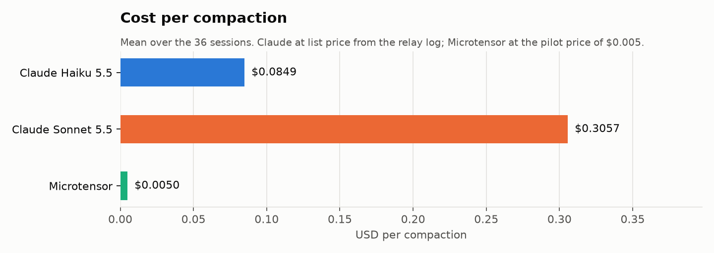
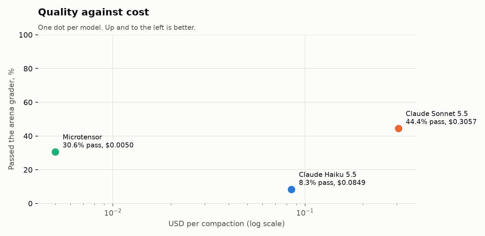
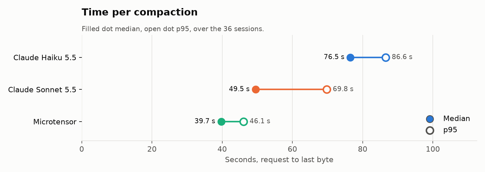
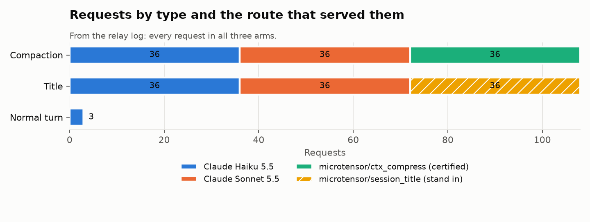
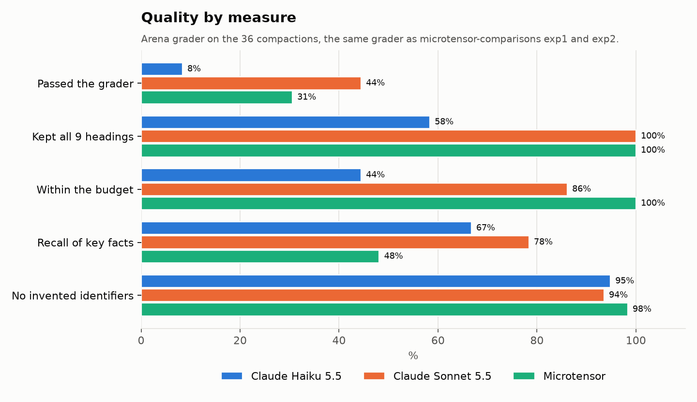
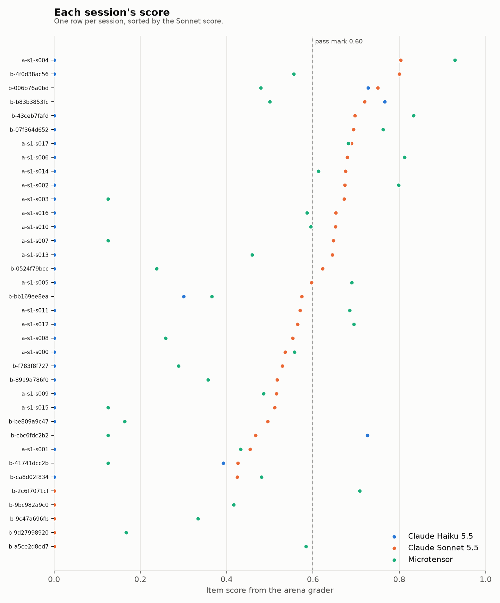

Numbers: [cost_per_compaction.csv](charts/cost_per_compaction.csv)

Numbers: [quality_vs_cost.csv](charts/quality_vs_cost.csv)

Numbers: [time_per_compaction.csv](charts/time_per_compaction.csv)

Numbers: [requests_by_type_and_route.csv](charts/requests_by_type_and_route.csv)

Numbers: [quality_by_measure.csv](charts/quality_by_measure.csv)

Numbers: [session_scores.csv](charts/session_scores.csv)
